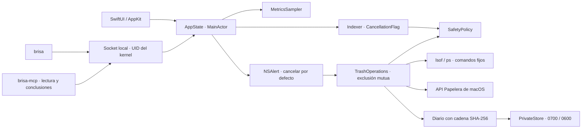

## Flujos de herramientas, planificación revisable y barra de menús primero · 13 de noviembre de 2026

- **Contratos comunes de planificación y diario (`OperationPlan`, `OperationExecutionReport`, `OperationJournalRecorder`)**: separan descubrimiento, medición, evaluación de bloqueos (`OperationBlocker`), generación del plan revisable (elementos afectados, elementos conservados, base `measured`/`estimated`/`mixed`, guía de regeneración, mecanismo `trash`/`toolCommand`/`mixed` y restaurabilidad `trashRestore`/`partialTrashRestore`/`irreversible`) y ejecución posterior con estados en diario `planned`, `completed`, `rejected`, `failed`, `cancelled` y `partial` (registrando qué se completó y qué se omitió sin afirmar reversión ante cancelaciones parciales).
- **Transporte estructurado de subprocesos (`CommandTransport.swift`)**: `CommandExecuting` y `LiveCommandExecutor` ejecutan argumentos estructurados directos sobre el binario localizado (`ExecutableLocator`) sin invocación de shell (`/bin/sh` / `-c`), con límites de tiempo, tope de bytes de salida y cancelación cooperativa conectada a `ScanControl`.
- **Cinco módulos de dominio desacoplados en `BrisaCore`**:
  1. `ProjectArtifactCleanup.swift` (`ProjectArtifactCleaner`, `ProjectArtifactCleanupPolicy`, `ProjectArtifactGroup`): amplía `WorktreeAndProjectDetector` y separa su política de la `SafetyPolicy` global. Bloquea enlaces simbólicos, subrepositorios `.git`, archivos rastreados por Git, origen no verificable y proyectos/procesos activos, moviendo candidatos aprobados a la Papelera tras revalidación.
  2. `PackageManagerAdapters.swift` (`PackageManagerService`, protocolo `PackageManagerAdapter`, `HomebrewAdapter`, `NpmAdapter`, `PnpmAdapter`, `YarnAdapter`): descubre versión real, rutas de caché, alcance completo (`PackageManagerCacheScope`) y capacidades soportadas por cada herramienta, midiendo caché antes y después cuando aplica sin tocar paquetes instalados, configuraciones ni credenciales.
  3. `ExactDuplicates.swift` (`DuplicateScopePolicy`, `ExactDuplicateScanner`, `DuplicateCleaner`): política independiente con lectura de contenido limitada exclusivamente a carpetas autorizadas; canalización por tamaño, muestra parcial y SHA-256 en streaming sin cargar archivos grandes completos; exclusión de symlinks, cloud-only y paquetes `.app`; detección de hardlinks (mismo inodo) y clones APFS; y doble verificación SHA-256 + identidad POSIX tanto de las copias seleccionadas como de la copia protegida conservada antes de mover a la Papelera.
  4. `AppUninstaller.swift` (`AppUninstaller`, `AppRunningChecking` / `LiveAppRunningChecker`): descubre aplicaciones y sus artefactos relacionados clasificándolos por confianza (`AppMatchConfidence`) y nivel (`AppAssociationTier`: exclusivo, posible compartido con otras apps instaladas, incierto y pendiente por privilegios); bloquea aplicaciones del sistema o en ejecución y revalida antes de mover a la Papelera.
  5. `DockerManager.swift` (`DockerManager`): consulta CLI y daemon, parsea salidas JSON oficiales por recurso (contenedores, imágenes, caché de compilación y volúmenes), protege volúmenes por defecto, expone dependencias entre recursos y exige revalidación del estado antes de ejecutar comandos destructivos irreversibles.
- **Coordinación UI modular (`BrisaApp`)**: `ToolsCoordinator` centraliza estado de análisis, planes pendientes (`PendingPlanContext`) y ejecución asíncrona fuera de `AppState.swift` (`AppState` mantiene su instancia de coordinación `tools`, inyecta también `trashMover` en `TrashOperations`, refresca el diario y calcula `JournalSummary` sin mezclar resúmenes `plan-*` con traslados individuales a Papelera). La interfaz separa `MenuPanel`/`MenuPanelViews`/`MenuPanelRoutes` (inicio adaptable con desplegable de rendimiento, rutas inline `.reviewCandidates`, `.exploreSpace` y `.toolsHub` con retorno por pila `MenuPanelRoute` y revisión sin abrir la ventana principal salvo acción explícita), la navegación principal simplificada (`Inicio`, `Limpiar` con modos `Candidatos`, `Explorar espacio`, `Duplicados` y `Avanzado`, `Aplicaciones` con `AppUninstallerDetailView`, `Historial` en `ActivityView` y `Ajustes` con el bloque desplegable `settings.advanced` para `AgentsView`), el resumen previo de `OperationPlanReviewView` orientado al usuario y las tablas ES/EN desacopladas en `Localization`/`ToolsLocalization` (`Tools.strings`, `MenuBar.strings`, `Activity.strings`, `AppsAgents.strings`, `Overview.strings`, `Findings.strings`, `Settings.strings`).
- **Alcance CLI y MCP**: `BrisaCLI` (`brisa`) y `BrisaMCP` (`brisa-mcp`) siguen operando sobre el inventario de 11 categorías, diagnósticos, mapa de espacio, selección y diario (`9` herramientas MCP estrictamente de solo lectura); los cinco nuevos flujos se coordinan y confirman nativamente desde `BrisaApp` (`ToolsCoordinator` + `BrisaCore`).

## Optimización de telemetría, estado UI y motor de disco · 13 de noviembre de 2026

- **Telemetría desacoplada y ciclo de vida (`LiveMetricsStore`, `Metrics`, `LiveHardwareBreakdown`, `SystemDiagnostics`)**: un único `MetricsSampler` compartido abastece a la franja general y al desglose de hardware mediante una única lectura `HOST_VM_INFO64`. El sondeo de desglose (2 s) solo corre con el popover abierto y pausa el temporizador redundante de 3 s de ventana; al cerrar ventana y popover, ocultar o minimizar la app, o suspender el equipo, los temporizadores y tareas en vuelo se detienen y se descartan resultados tardíos tras el cierre. Las peticiones `sample(maxAge:forceSnapshots:)` esperan y relanzan una captura forzada si coincidieron con una no forzada en vuelo, evitando bloqueos y lecturas incompletas. La atribución por proceso usa `(pid, startTimeMicros)` sobre `sysctl(KERN_PROC_ALL)` y `/bin/ps` (sin `comm=`), distingue núcleos/base de CPU, evita fabricar RAM del sistema mediante `memoryUsed - totalRSS` (publicando `totalObservedProcessRSSBytes`), separa actividad proporcional entre clientes Metal de utilización global GPU y acota `AppIconCache` a 128 entradas (`NSCache`).
- **Proyecciones UI y respuesta (`AppState`, `RootView`, `FindingsView`, `OverviewView`, `MenuPanel`)**: `RootView` conserva la jerarquía y el estado transitorio (`selected`, `page`, `query`) al cambiar idioma ES/EN/Sistema sin `.id(state.effectiveLanguageCode)` y usa el nuevo pipeline modular `Localization` + orientación de regeneración (`RegenerationGuidance`). `AppState` cachea resúmenes filtrados, `JournalSummary`, totales y restos de aplicaciones, coalesce el progreso del análisis a ~100 ms conservando siempre el snapshot final, aplana `FindingsView` en un único `LazyVStack`, y ejecuta `findings`/`mcp.*` y la comprobación inicial de rutas fuera de `MainActor` empleando `IndexedFile.toJSONValue()`.
- **Motor de disco unificado (`Paths`, `ReadAuthorizationPolicy`, `PatternMatcher`, `StorageMeasurement`, `CategoryDetector`, `WorktreeAndProjectDetector`)**: vía rápida UTF-8 `Paths.isAlreadyNormalized`, prefijos pre-normalizados en minúsculas sin particionado repetido en el bucle interno de `readdir`/`lstat`, cierre explícito de descriptores `DIR*` tras enumerar entradas, recorrido depth-1 POSIX en `CategoryDetector`, detección simultánea de `.git`, `S_IFLNK` y subcarpetas protegidas en `StorageMeasurement.measure`, y `WorktreeAndProjectDetector.scanAll` en una sola pasada sobre las raíces de proyecto.

## Actualización de inventario y rendimiento · 13 de noviembre de 2026

`ScanControl` comparte cancelación y deadline con los detectores y subprocesos. El descubrimiento reserva presupuesto para medir; la fase contextual tiene un límite separado y publica su cobertura. `Paths.openDirectory` abre directorios sin seguir symlinks y rechaza FIFO/dispositivos como directorios.

El mapa de inventario comparte la consulta de la lista; su clave de caché incluye los filtros. El mapa de Vista general y las consultas CLI mantienen el alcance global y no heredan búsquedas ocultas.

`InventoryQuery` centraliza filtros y ordenación; `AppState` cachea la proyección y los mapas por snapshot/consulta/idioma. Las métricas no invalidan esos cálculos. `LiveMetricsStore` es un observable independiente: solo las regiones que lo observan se actualizan por el reloj de telemetría. Se cachean los totales de la consulta y se resuelve la selección mediante un índice por ID. Los cambios de alcance invalidan todas las vistas derivadas y los resultados contextuales.

`InventoryMetadata` conserva las restricciones del elemento catalogado en las reconsultas MCP. Las consultas contextuales leen el snapshot publicado; no lanzan trabajo pesado por encontrar una lista vacía. `ScanOpenFileInspector` agrupa consultas del análisis; las operaciones conservan su revalidación final independiente.

Las raíces persistidas delimitan alcance, pero no representan por sí solas autorización TCC. `authorizedPromptRoots` procede del selector nativo de la sesión, y las ubicaciones protegidas pendientes se omiten antes de abrirlas. Esta versión no persiste bookmarks de seguridad.

---

# Arquitectura e inventario base

## Origen del paquete

El paquete Swift de **Brisa** se construyó como un proyecto independiente de macOS sin dependencias externas de SwiftPM ni conexión de red en ejecución, organizado en `BrisaCore` (biblioteca de dominio y seguridad), `BrisaApp` (interfaz SwiftUI/AppKit de barra de menús y ventana), `BrisaCLI` (`brisa`) y `BrisaMCP` (`brisa-mcp`).

## Componentes y contratos

Hay una biblioteca `BrisaCore` con componentes separados por responsabilidad, tres targets ejecutables y dos targets de pruebas (`BrisaCoreTests` y `BrisaAppTests`). No hay una dependencia circular entre UI, CLI y servidor MCP. Los componentes de la biblioteca son módulos lógicos en archivos separados; no se afirma que cada archivo sea un target SwiftPM independiente.

| Componente | Contrato y límite |
| --- | --- |
| `MetricsSampler` | Snapshot medido; métricas opcionales representan indisponibilidad. Muestreo periódico fuera del hilo principal. |
| `SafetyPolicy` | Raíces explícitas, exclusiones, identidad POSIX, rechazo de enlaces y revisión de elegibilidad. Sin efectos destructivos. |
| `Indexer` | Enumeración acotada, sin leer contenido, cancelación cooperativa, errores y resultados parciales. |
| `ProcessInspector` | `ps` del UID actual y `lsof` para archivos individuales. No lee argumentos, entorno ni credenciales. |
| `GitInspector` | Estado real de un repositorio; no ejecuta hooks de usuario mediante shell ni elimina worktrees. No establece integración con rama principal. |
| `AgentDiscovery` | Detección de rutas ejecutables conocidas; no lanza los proveedores ni interpreta la instalación como sesión autenticada. |
| `AgentValidator` | Máximo 100 conclusiones, IDs existentes, tamaños coincidentes, confianza finita, texto acotado. Sin autoridad para actuar. |
| `TrashOperations` | Lote serial de hasta 100 archivos. Revalida, comprueba actividad, abre sin seguir symlinks, bloquea de forma consultiva y mueve mediante la API oficial. |
| `Journal` | Intención y resultado por elemento, cadena SHA-256 verificada al leer, restauración conservadora. |
| `PrivateStore` | Estado JSON privado; `O_NOFOLLOW`, límite de 32 MiB, archivo temporal y rename, fsync. |
| `IPCServer` | Socket Unix con modo 0600 en directorio 0700; `getpeereid` en ambos extremos y protocolo versionado. |
| `MCPService` | Lista cerrada de herramientas, sin rutas arbitrarias ni comandos. Transporte stdio separado de la app. |
| `AppState` | Selección, confirmación nativa, tareas, permisos explícitos y coordinación de UI e IPC. |

## Estado, concurrencia y errores

SwiftUI observa estado en `MainActor`. Los análisis, métricas, búsquedas de aplicaciones y operaciones de archivos se ejecutan con prioridad utility. Las operaciones de limpieza se serializan mediante un lock, y la app no permite analizar o modificar raíces durante una operación. La selección se borra al analizar, proteger una ubicación o completar una limpieza. Las conclusiones externas no modifican esa selección.

El servidor acepta una solicitud por conexión, hasta ocho conexiones atendidas a la vez y una sola petición de mutación; las lecturas permanecen disponibles durante una hoja de revisión. La app vuelve a validar las opciones de CLI; no confía únicamente en el parser del ejecutable. Los errores se devuelven en una envoltura estructurada. Un diario corrupto impide limpiar; no se sustituye silenciosamente por un diario vacío.

La aprobación humana pertenece al coordinador de la app. Los métodos públicos de `TrashOperations` no muestran diálogos por sí mismos: cualquier consumidor futuro de la biblioteca debe conservar una confirmación equivalente. La hoja de confirmación es asíncrona; el IPC admite hasta ocho conexiones y solo una petición de mutación a la vez, permitiendo lecturas durante la revisión. Cada recepción respeta un deadline total y los errores conservan la correlación de peticiones decodificadas. El servidor MCP no es una identidad de menor privilegio dentro del IPC; su lista cerrada de herramientas limita la interfaz del puente, mientras que un proceso que ya tenga el mismo UID puede hablar el protocolo local completo. Las acciones destructivas de los ejecutables distribuidos siguen pasando por el coordinador y su confirmación.

El índice es transitorio: reiniciar exige un nuevo análisis. Las preferencias, protecciones, últimas 100 entradas de actividad y diario persisten en `~/Library/Application Support/Brisa`. Idioma y apariencia se sincronizan con el dominio propio de UserDefaults; la bienvenida usa ese dominio. Los fallos de guardado se muestran y una cancelación de la hoja tiene un resultado propio, sin presentarse como un error de seguridad.

## Interfaz y accesibilidad

Identidad verde menta y grafito, marca de aire creada con paths vectoriales nativos. Ventana con navegación lateral, tarjetas de recursos, revisión agrupada por categoría y panel de detalle. `MenuBarExtra` ofrece el resumen compacto. ⌘K abre la paleta. Los controles de acción son `Button`, `Toggle`, `Picker` y campos nativos; los checkboxes de archivo tienen etiquetas con la ruta y el estado seleccionado de navegación es explícito. Los elementos decorativos se ocultan a accesibilidad cuando corresponde.

La interfaz principal tiene textos en español e inglés mediante `L10n` y las tablas modulares `*.strings`; se puede elegir idioma en Ajustes (Español, English o Automático del sistema). No se presenta como una traducción completa del sistema, los mensajes internos de Git/`lsof` o los diagnósticos del motor. Las pruebas auditivas completas con VoiceOver y zoom requieren validación humana adicional.

## Extensiones y límites actuales

Los adaptadores ejecutables para agentes/proveedores necesitan antes un prototipo de aislamiento con pruebas de denegación de lectura/escritura y política de red por proveedor. No se proporciona una opción que simplemente active un proceso sin aislamiento. Apple Intelligence requiere comprobaciones de API, sistema y dispositivo que aquí no se han implementado.

El desinstalador de aplicaciones (`AppUninstaller` + `AppUninstallerDetailView`) clasifica los restos asociados por confianza y nivel (`exclusive`, `possibleShared`, `uncertain` y `privilegePending`) con plan revisable antes de mover a la Papelera. Un futuro eliminador de worktrees deberá fijar repositorio común, destino de merge, bloqueo, actividad y estado limpio inmediatamente antes de usar `git worktree remove` en lugar de reutilizar `TrashOperations`.
