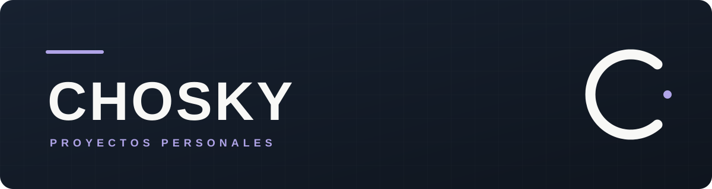

  

# Oye, soy Chosky 👋

Me gusta coger una idea, trastear con ella y ver hasta dónde puede llegar. Aquí voy dejando mis inventos: apps, juegos, herramientas y proyectos para aprender ciberseguridad y redes.

Mucho vibecoding, ayuda de IA y ganas de entender cómo funcionan las cosas. Algunos proyectos están más avanzados y otros siguen en construcción; en cada README cuento qué hace cada uno y los peros que tiene.

## Algunos de mis inventos 🚀

| Proyecto | ¿De qué va? |
| --- | --- |
| [ChoskoLabs](https://github.com/erchosky/choskolabs) | Laboratorios para aprender ciberseguridad jugando y entender qué ha pasado después de capturar la flag. |
| [OSI Quest](https://github.com/erchosky/osi-quest) | Aprender las siete capas de OSI con ejemplos y actividades, sin quedarse solo con la teoría. |
| [CyberSword](https://github.com/erchosky/cybersword) | Herramientas defensivas en la terminal para revisar correos, enlaces y otras cosas sospechosas. |
| [Brisa](https://github.com/erchosky/brisa) | Una app para mirar el espacio del Mac y revisar opciones de limpieza. |
| [Chodiag](https://github.com/erchosky/chodiag) | Un diagnóstico para investigar por qué un PC con Windows va raro. |
| [CarnIA](https://github.com/erchosky/carnia) | Practicar el teórico del carné con retos, partidas y piques. |

También hay proyectos de juegos, herramientas para Mac y más cosas en la pestaña de [repositorios](https://github.com/erchosky?tab=repositories).

## ¿Qué me vas a encontrar haciendo? 🛠️

Aprendiendo redes y ciberseguridad, probando herramientas de IA y montando proyectos que me gustaría usar. Si algo de por aquí te sirve, de lujo. Y si está a medio hacer... pues otro invento en marcha, sabeehh.
